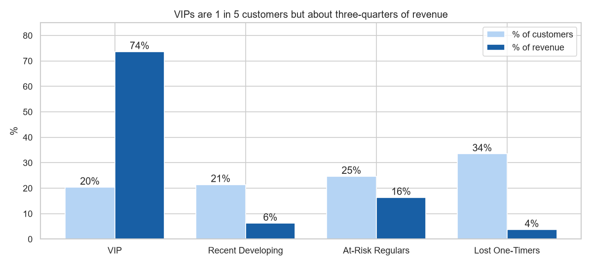
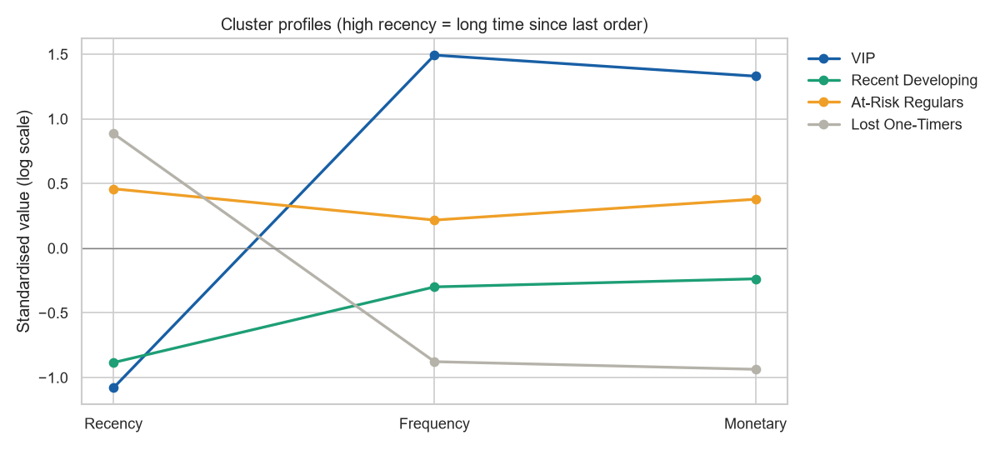
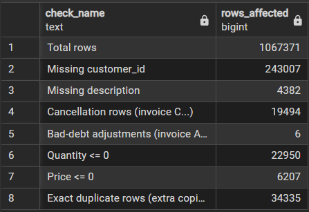
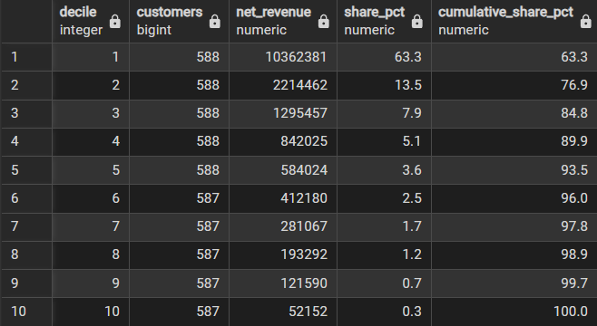
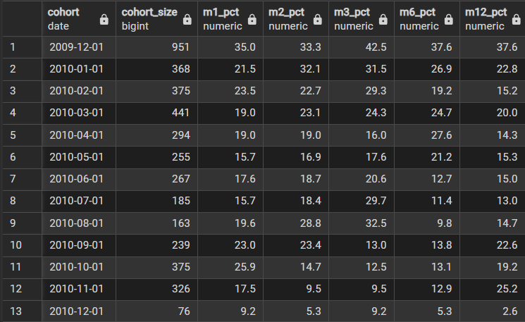
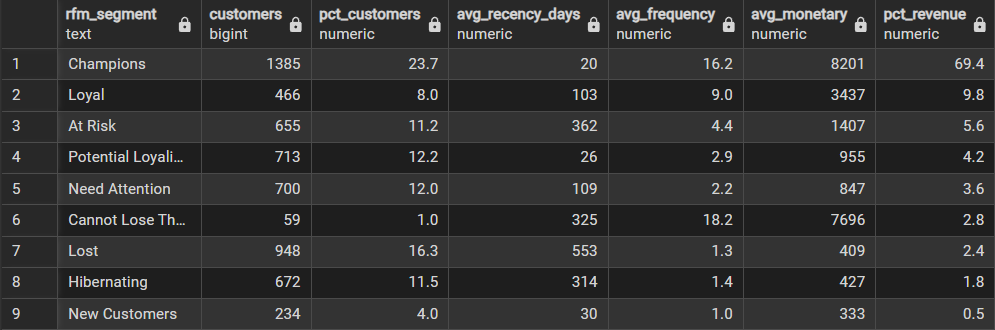
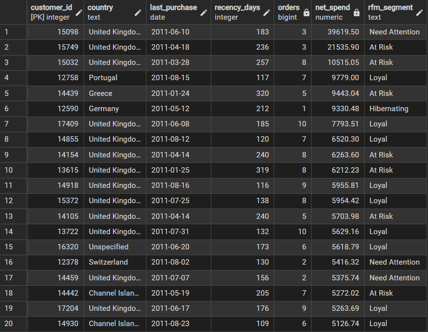
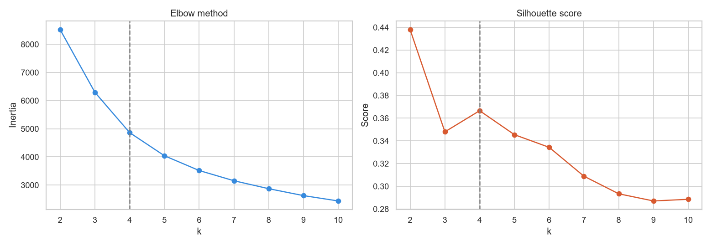
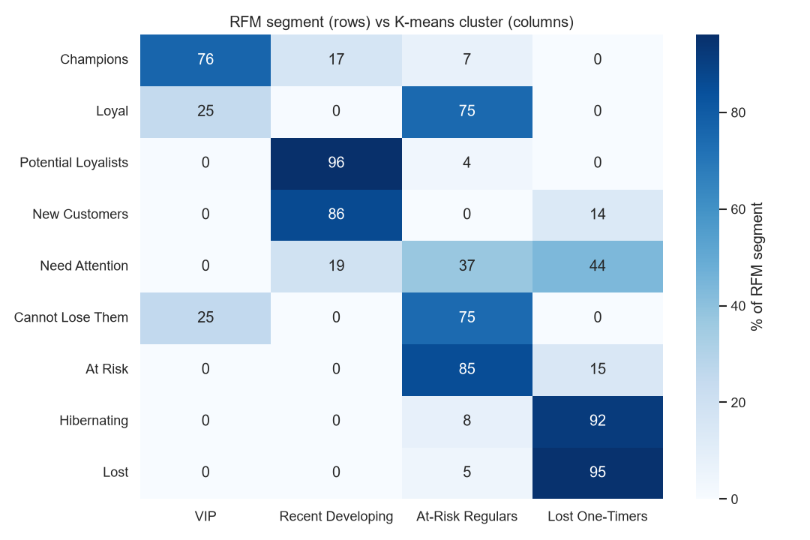

#  Customer Segmentation Analysis — PostgreSQL + K-Means

Segmenting **5,832 real customers** of a UK online gift retailer (1.07M transactions, Dec 2009 – Dec 2011) using **SQL-built RFM features** and **K-means clustering**, then turning the segments into actions a marketing team can use.



##  Business Questions
1. Who are the most valuable customers, and how dependent is revenue on them?
2. Which customers are drifting away, and how much revenue do they represent?
3. Do data-driven clusters agree with traditional rule-based RFM segments?
4. What should marketing do differently for each group?

##  Key Insights

**1. One customer in five drives three-quarters of revenue.**
The VIP cluster is 20% of customers but **73.7% of net revenue**. In SQL, the top 10% of customers alone account for **63.3%**.
→ *Recommendation:* protect VIPs with account management and early access. Losing a handful of them would hurt more than losing all the one-time buyers put together.

**2. Rule-based "Loyal" customers are already slipping, and K-means caught it.**
**75%** of customers labelled *Loyal* by RFM rules, and 75% of *Cannot Lose Them*, fall into the **At-Risk Regulars** cluster (median 183 days since last order).
→ *Recommendation:* don't rely on RFM labels alone. Use the cluster as an early-warning flag and contact these customers before they lapse.

**3. £1.33M of past revenue is still recoverable.**
At-Risk Regulars are 1,438 customers with £2.68M lifetime revenue. **734 of them last ordered 90–365 days ago**, recent enough to win back, with £1.33M in lifetime spend. `sql/06_cluster_analysis.sql` (6.5) produces the ranked win-back list.
→ *Recommendation:* a personalised re-engagement campaign for these 734 customers, starting with the top 20 by spend.

**4. Q4 brings in new customers, and January decides whether they stay.**
Revenue from the Recent Developing cluster grew from **£8K in Jan 2011 to £260K in Nov 2011**. 464 of its 1,250 customers made their first purchase in Sep 2011 or later. Yet only **9–26%** of new customers in each 2010 cohort ordered again the following month.
→ *Recommendation:* a second-order campaign every January, aimed at the customers acquired in Q4.

**5. A third of customers are low-value one-timers.**
Lost One-Timers are 33.5% of customers but only 3.7% of revenue (median one order, £267, 402 days ago).
→ *Recommendation:* low-cost contact only, such as one seasonal email before Q4. Don't spend acquisition-level budgets on them.

##  The Four Segments

| Cluster | Customers | Median days since order | Median orders | Median spend | % revenue | Action |
|---|---|---|---|---|---|---|
| **VIP** | 1,190 (20%) | 17 | 13 | £4,808 | 73.7% | Protect |
| **Recent Developing** | 1,250 (21%) | 24 | 3 | £703 | 6.2% | Grow (second order) |
| **At-Risk Regulars** | 1,438 (25%) | 183 | 5 | £1,435 | 16.4% | Win back now |
| **Lost One-Timers** | 1,954 (34%) | 402 | 1 | £267 | 3.7% | Low-cost only |



##  Pipeline

```
online_retail_II.xlsx ──► CSV ──► PostgreSQL (raw, all TEXT)
                                     │  02 data quality audit
                                     │  03 clean + type + net cancellations
                                     │  04 exploratory analysis (CTEs, window functions, cohorts)
                                     │  05 RFM features + rule-based segments
                                     ▼
                         Python: log transform → scale → K-means (k=4)
                                     │  profile, compare with RFM
                                     ▼
                         PostgreSQL: customer_clusters ──► 06 cluster analysis + win-back list
```
##  SQL Highlights

**Data quality audit:** every issue counted before cleaning


**Revenue concentration:** top 10% of customers = 63.3% of revenue (`NTILE` + running `SUM OVER`)


**Cohort retention:** share of each monthly cohort that comes back (`DATE_TRUNC` + `AGE` + `FILTER`)


**Rule-based RFM segments**


**Win-back list:** top recoverable At-Risk customers, ready for marketing


##  Skills Demonstrated

| Area | What I did |
|---|---|
| **SQL (PostgreSQL)** | Staging table loaded as TEXT, then cast with error-safe conversion; data-quality audit; CTEs; aggregates with `FILTER`; window functions (`LAG`, running `SUM OVER`, `RANK`, `NTILE`, `PERCENTILE_CONT`); `DATE_TRUNC` and `AGE` for monthly cohort retention; indexes and a primary key |
| **Feature engineering** | Recency, frequency and net monetary value, plus tenure, average order value, product breadth and return rate, all built in SQL |
| **Clustering** | Log transform for skewed features, standardisation, K-means with k chosen by elbow and silhouette, PCA for a 2-D view, rule-based cluster naming so labels stay stable |
| **Validation** | Compared K-means clusters against rule-based RFM segments with a cross-tab heatmap |
| **Python ↔ SQL** | Read features with SQLAlchemy, wrote cluster labels back to PostgreSQL, then analysed them in SQL |

##  Data Cleaning Decisions

| Issue | Rows | Decision |
|---|---|---|
| Missing customer ID | 243,007 | Removed. Anonymous purchases can't be segmented |
| Exact duplicates | 34,335 | Removed |
| Cancellations (invoice `C…`) | 19,494 | **Kept and netted off.** One customer ordered 80,995 units and cancelled 12 minutes later; deleting cancellations would have counted that as a £168K sale |
| Price ≤ 0 | 6,207 | Removed (free samples, write-offs) |
| Non-product codes (postage, fees, manual adjustments, vouchers, tests) | ~5,900 | Removed. They aren't customer purchases |
| Bad-debt adjustments (invoice `A…`) | 6 | Removed |
| Customers with zero/negative net spend | 43 | Excluded from segmentation |

##  Feature Definitions

| Feature | Definition |
|---|---|
| Recency | Days between the last purchase and 10 Dec 2011 (the day after the data ends) |
| Frequency | Number of distinct purchase invoices |
| Monetary | Net revenue: purchases minus cancellations (£) |
| R / M score | `NTILE(5)` (5 = best) |
| F score | Business thresholds (1, 2, 3–4, 5–9, 10+ orders), because many customers tie on 1 order and `NTILE` would split identical customers into different scores |

##  Choosing k



k = 2 has the highest silhouette score (0.44) but only separates "good" from "bad" customers. After k = 2, the silhouette peaks again at **k = 4 (0.37)**, which is also where the elbow bends, and four clusters map to four distinct actions.

##  RFM Rules vs K-Means



##  Repo Structure
```
├── sql/
│   ├── 01_setup_and_load.sql    # schema + staging table + load instructions
│   ├── 02_data_quality.sql      # audit of every data issue
│   ├── 03_clean.sql             # clean, typed transactions table
│   ├── 04_eda.sql               # 7 business questions (window functions, cohorts)
│   ├── 05_rfm.sql               # RFM features, scores, rule-based segments
│   └── 06_cluster_analysis.sql  # cluster profiling + win-back list
├── notebooks/customer_clustering.ipynb
├── scripts/xlsx_to_csv.py
├── images/                      # charts used in this README
├── docs/BUILD_GUIDE.md
└── requirements.txt
```

##  How to Reproduce
1. Install PostgreSQL 16 and Python 3.11+, then run `pip install -r requirements.txt`.
2. Download `online_retail_II.xlsx` from UCI (link below) into `data/`, then run `python scripts/xlsx_to_csv.py data/online_retail_II.xlsx data/online_retail_II.csv`.
3. Create the database `customer_segmentation` and run `sql/01` → load the CSV → `sql/02` to `sql/05`.
4. Set your password in the notebook and run it. Then run `sql/06`.

Full step-by-step instructions with checkpoints: [docs/BUILD_GUIDE.md](docs/BUILD_GUIDE.md)

##  Data Source
Chen, D. (2012). *Online Retail II* [Dataset]. UCI Machine Learning Repository. https://doi.org/10.24432/C5CG6D

---
**Danysh** · B.CS (Hons.) Data Science, Multimedia University · [LinkedIn](https://www.linkedin.com/in/muhammad-danysh-hykal-9213581b7/) · [GitHub](https://github.com/danyshykal)
